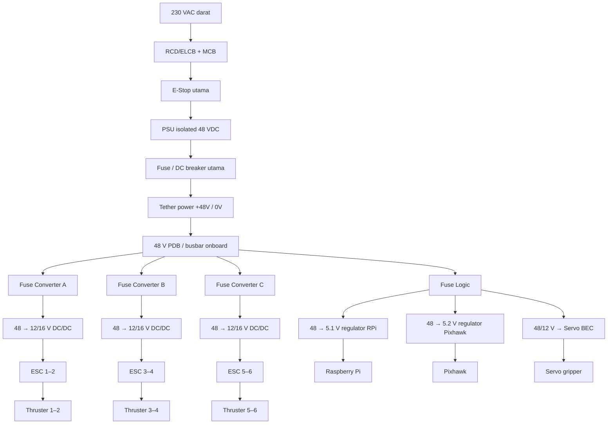
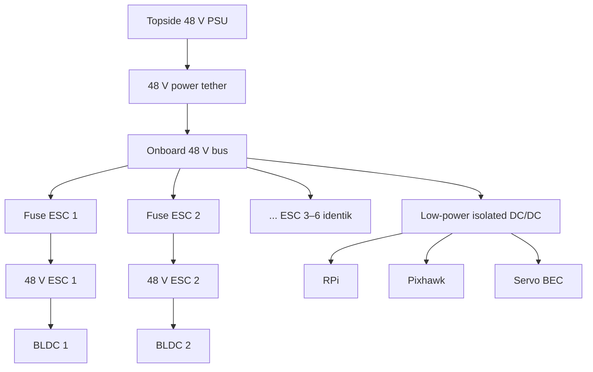
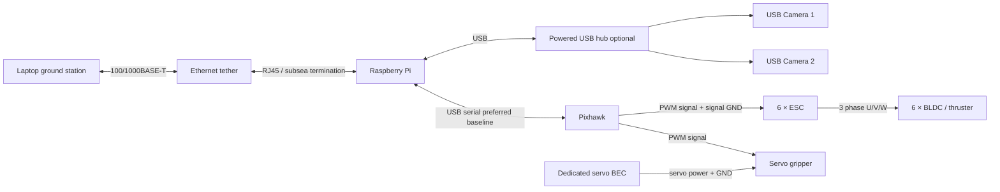

# Riset Sistem Elektrikal ROV UNDIP untuk Persiapan KKI 2027

## Ringkasan keputusan desain

Pada 20 November 2026, saya belum menemukan **Panduan KKI 2027 resmi** dari Belmawa/Kemdiktisaintek. Dokumen resmi terbaru yang tersedia adalah Panduan KKI 2026 yang diumumkan 19 Mei 2026. Karena itu, semua persyaratan lomba di bawah yang berasal dari KKI 2026 harus diperlakukan sebagai **baseline/proyeksi**, bukan ketentuan final 2027. citeturn918990search0turn918990search1

Untuk ROV 2026, panitia mensyaratkan ROV memiliki **gripper dan kamera**, GUI menampilkan dua kamera—kamera bawah dan kamera dinding—serta misi yang mencakup pengambilan dan pemindahan payload. Dimensi maksimum ROV pada 2026 adalah 35 × 35 × 35 cm di luar gripper, dan durasi satu run maksimum 20 menit. Dokumen juga menyebut ROV dioperasikan dari permukaan melalui umbilical/tether. Semua angka tersebut perlu diverifikasi ulang ketika panduan 2027 terbit. citeturn246456view0turn126239view0

Dari sisi elektrikal, keputusan paling penting justru belum terkait pemilihan Raspberry Pi atau Pixhawk, melainkan **arsitektur distribusi daya**. Bila enam thruster berada di kelas Blue Robotics T200, daya maksimum teoritisnya sudah sekitar **1,23 kW pada 12 V** atau **2,34 kW pada 16 V**, sebelum Raspberry Pi, kamera, servo, dan elektronik lain diperhitungkan. Satu T200 sendiri tercatat menarik 17 A/205 W pada 12 V, 24 A/390 W pada 16 V, dan 32 A/645 W pada 20 V. citeturn773537search5

Implikasinya besar: mengirim 12–16 V langsung dari darat melalui tether menghasilkan arus sangat tinggi dan rugi kabel yang besar. Untuk sistem yang benar-benar ditenagai dari darat, saya merekomendasikan menjadikan **48 VDC sebagai kandidat utama bus tether**, kemudian menurunkan tegangan di ROV, atau—bila menggunakan thruster custom—memilih motor dan ESC yang memang dirancang bekerja langsung pada bus 36–48 V sehingga konversi berdaya besar dapat dikurangi. Pilihan final baru boleh dikunci setelah tim mengukur **arus kerja, arus puncak, dan perilaku blocked-rotor/stall** thruster aktual.

Untuk anggaran, enam T200 asli kurang realistis untuk skenario Rp20 juta. Harga produsen saat ini mulai USD230 per unit; pada JISDOR Bank Indonesia 20 November 2026 sebesar Rp18.278/USD, enam unit saja setara sekitar **Rp25,2 juta sebelum ESC, pengiriman, bea, dan pajak**. Basic ESC Blue Robotics saat ini sekitar USD44 per unit, sehingga enam ESC menambah sekitar Rp4,8 juta sebelum impor. citeturn559588search12turn949619search26turn226771search0

Karena itu, untuk dana Rp20 juta, pendekatan yang paling masuk akal adalah **thruster custom/BLDC dengan karakterisasi elektrikal yang serius**, sedangkan dana Rp30–35 juta sebaiknya dipakai terutama untuk meningkatkan reliabilitas distribusi daya, converter, penetrator, proteksi, instrumentation, dan spare—bukan semata-mata membeli komputasi yang lebih mahal.

## Parameter yang harus dikunci sebelum desain final

Beberapa parameter di bawah tidak boleh “diisi dengan asumsi” karena masing-masing dapat mengubah ukuran kabel, PSU, ESC, fuse, serta converter secara signifikan.

| Parameter | Mengapa kritis | Status saat ini |
|---|---|---|
| Panjang tether aktual | Menentukan resistansi kabel, voltage drop, rugi daya, dan kelayakan Ethernet tembaga | Belum diketahui |
| Kedalaman maksimum | Menentukan rating penetrator/konektor dan konsekuensi kegagalan isolasi | Belum diketahui; venue 2027 belum diumumkan |
| Tegangan motor/thruster nominal | Menentukan bus propulsion dan converter | Belum dipilih |
| Arus kontinu setiap thruster | Menentukan ESC, kabel cabang, fuse dan PDB | Belum diukur |
| Arus transient/blocked rotor | Menentukan proteksi dan kemampuan PSU menghadapi transient | Belum diukur |
| Duty cycle enam thruster | Menentukan apakah PSU perlu menanggung seluruh enam thruster pada full power secara simultan | Belum diketahui |
| Model Raspberry Pi | Pi 4 dan Pi 5 memiliki kebutuhan daya berbeda | Belum dipilih |
| Model Pixhawk | Pinout, rail, dan konektor berbeda antar model | Belum dipilih |
| Tegangan dan stall-current servo | Menentukan BEC khusus gripper | Belum dipilih |
| Model kamera dan konsumsi USB | Menentukan apakah perlu powered USB hub | Belum dipilih |
| Topologi tether | Kabel data dan power terpisah, bundle bersama, Fathom, atau kabel custom | Belum dipilih |
| Ketentuan inspeksi listrik KKI 2027 | Bisa mengubah E-stop, enclosure, tether atau prosedur keselamatan | Belum diterbitkan |

Untuk Raspberry Pi, opsi elektrikal yang relevan adalah Pi 4 dan Pi 5. Raspberry Pi 4 direkomendasikan menggunakan 5 V/3 A, sedangkan Raspberry Pi 5 direkomendasikan 5 V/5 A; Pi 5 yang hanya menerima suplai 3 A membatasi downstream USB power menjadi 600 mA, sementara suplai 5 A memungkinkan hingga 1,6 A untuk perangkat USB. Dua webcam menjadikan detail ini cukup penting. citeturn773537search0turn773537search1

Pi 5 menyediakan dua USB 3.0, dua USB 2.0, Gigabit Ethernet, serta input 5 V/5 A melalui USB-C. citeturn773537search9 Karena tugas elektrikal ROV tidak dengan sendirinya memerlukan RAM 8 GB, **Pi 4 4 GB layak dijadikan baseline cost-conscious** sampai kebutuhan komputasi software benar-benar diketahui. Harga lokal November 2026 yang saya temukan sekitar Rp2,998 juta untuk Pi 4 4 GB, sedangkan Pi 5 8 GB sekitar Rp4,998 juta; Digiware juga menampilkan Pi 5 8 GB sekitar Rp4,976 juta dengan stok Surabaya saat halaman diindeks. citeturn559588search1turn559588search4

Untuk autopilot, Holybro Pixhawk 6C merupakan kandidat masuk akal karena tercantum sebagai hardware yang memiliki build ArduPilot/ArduSub. ArduPilot tetap memperingatkan bahwa ketersediaan firmware tidak berarti setiap board telah diuji langsung oleh tim pengembang pada setiap konfigurasi. citeturn255920search0turn255920search1

Pixhawk 6C mempunyai 16 keluaran PWM. Input POWER1/POWER2 normalnya berada sekitar 4,9–5,5 V, sedangkan USB 4,75–5,25 V; servo rail merupakan domain terpisah. PX4 secara eksplisit menyatakan tegangan servo rail harus sesuai dengan servo yang digunakan. citeturn773537search2turn773537search3 Ini menjadi alasan kuat agar servo gripper **tidak** mengambil daya dari rail 5 V autopilot atau Raspberry Pi.

Untuk KKI 2027, keputusan final mengenai dua kamera juga harus menunggu petunjuk teknis. KKI 2026 secara eksplisit membutuhkan dua tampilan kamera, tetapi belum ada dasar untuk menyatakan resolusi, frame rate, interface, atau lokasi persis kamera 2027 akan identik. citeturn126239view0

## Arsitektur daya dan komunikasi yang disarankan

### Arsitektur kandidat utama: 48 V tether, conversion onboard

Konsep ini paling cocok apabila tim tetap menggunakan motor/thruster 12–16 V tetapi daya utama berasal dari darat.

Keunggulan pendekatan 48 V adalah arus tether jauh lebih rendah dibanding mengirim daya yang sama pada 12 V. Pada daya 1,2 kW, arus ideal di 12 V adalah sekitar 100 A, sedangkan di 48 V sekitar 25 A. Karena rugi konduktor mengikuti \(P_{loss}=I^2R\), menurunkan arus menjadi seperempat secara ideal menurunkan rugi resistif menjadi sekitar seperenambelas untuk kabel yang sama.

Kekurangannya adalah kebutuhan converter besar onboard. Sebagai gambaran nyata, Mean Well SD-500L-12 menerima 19–72 VDC dan menghasilkan 12 V/40 A atau 500 W, dengan isolasi 2 kVAC dan harga RS Indonesia sekitar Rp2,276 juta per unit; tiga unit dapat membentuk tiga kanal propulsion dengan dua thruster per converter. citeturn303160search0 Tiga unit tersebut saja sudah sekitar Rp6,8 juta, sehingga pendekatan ini reliabel tetapi mahal untuk budget Rp20 juta.

Topside 48 V juga membutuhkan PSU cukup besar. Mean Well RSP-1000-48 berkapasitas 48 V/21 A atau sekitar 1 kW dan pada RS Indonesia tercantum sekitar Rp4,682 juta. RSP-1500-48 adalah model 1,5 kW dengan output 48 V/32 A; spesifikasi pabrik menyebut input universal 90–264 VAC dan proteksi short-circuit, overload, over-voltage serta over-temperature. citeturn731998search0turn731998search10

Untuk enam T200 pada full throttle 12 V, PSU 1 kW **tidak cukup** karena enam motor sendiri mencapai sekitar 1,23 kW. Sistem praktis memerlukan kelas sekitar 1,5 kW atau lebih setelah converter loss dan elektronik diperhitungkan. citeturn773537search5

### Arsitektur alternatif: thruster custom 36–48 V

Bila tim memang akan membuat unit propulsion sendiri menggunakan BLDC dan propeller custom, arsitektur yang secara elektrikal jauh lebih menarik adalah memilih **BLDC dan ESC bidirectional yang memang rated untuk bus 36–48 V**, sehingga bus tether dapat masuk langsung ke ESC.

Keuntungan utama adalah hilangnya converter propulsion 1–2 kW. Kekurangannya adalah motor, winding insulation, ESC, connector, dan praktik isolasi terhadap air harus benar-benar cocok dengan 48 V. Karena karakteristik motor custom kalian belum tersedia, saya tidak menganggap opsi ini otomatis aman.

### Arsitektur alternatif untuk tether sangat pendek: 24 V custom propulsion

Jika lomba ternyata menggunakan tether sekitar 10–15 m dan thruster custom dapat dirancang untuk 24 V, distribusi 24 V dapat menjadi kompromi. Arus pada daya 1 kW sekitar 42 A—masih besar tetapi jauh lebih rendah dari 83 A pada 12 V.

Untuk T200, pendekatan 24 V langsung **tidak boleh dipakai**, karena T200 hanya dispesifikasikan 7–20 V dan Blue Robotics merekomendasikan operasi nominal 12–16 V. citeturn773537search5turn773537search8

### Komunikasi Ethernet

Untuk kabel Ethernet copper biasa, batas standar 10/100/1000BASE-T adalah 100 m. Cisco juga mencatat kabel fleksibel multistrand sepanjang keseluruhan jalur dapat menjadi tidak stabil pada kisaran 60–70 m karena karakteristik transmisinya lebih buruk dibanding horizontal solid conductor cable. citeturn255920search7

Dengan demikian, kabel LAN laptop → Raspberry Pi **langsung** adalah pilihan yang wajar bila tether final cukup pendek. Jika panjang tether mendekati puluhan meter tinggi, kabel sering dilenturkan, ditempatkan berdekatan dengan power conductor dan enam ESC, maka margin EMC—**electromagnetic compatibility**, kemampuan sistem tetap bekerja tanpa saling mengganggu secara elektromagnetik—menjadi semakin penting.

Blue Robotics menyediakan contoh solusi subsea yang berbeda: Fathom-X membawa Ethernet 100 Mbps melalui satu twisted pair dan mereka menyatakan telah menguji komunikasi Standard Fathom Tether hingga 300 m. citeturn255920search5turn255920search10 Untuk KKI yang kemungkinan membutuhkan tether jauh lebih pendek, Fathom-X lebih merupakan opsi reliabilitas/EMI daripada kebutuhan bandwidth.

Saya menyarankan **konduktor power dan twisted-pair data tetap terpisah secara elektrikal**, walaupun berada dalam satu bundle fisik. Hindari mengirim arus thruster melalui conductor Ethernet yang sama.

## Wiring, interface, power domain, dan titik verifikasi

Arsitektur komunikasi yang paling sederhana tetap:

Raspberry Pi → Pixhawk paling aman dijadikan **USB sebagai baseline integrasi awal**, karena tidak memerlukan keputusan pin UART terlebih dahulu. Alternatif UART boleh digunakan kemudian, tetapi pinout dan level logic harus diverifikasi pada model board aktual. Pixhawk 6C menyediakan beberapa UART pada TELEM ports, tetapi posisi konektor dan mapping harus dirujuk ke dokumentasi board yang benar. citeturn255920search1

Untuk ESC Blue Robotics Basic, interface kontrol merupakan servo-style PWM pada level 3,3–5 V; 1100 µs adalah maksimum reverse, sekitar 1500 µs stop, dan 1900 µs maksimum forward. Rating ESC adalah 7–26 V dan hingga 30 A tergantung pendinginan. citeturn773537search6

Secara elektrikal, kabel antara Pixhawk dan ESC hanya membutuhkan **signal dan signal ground** bila ESC tidak memiliki BEC. Jalur propulsion power ESC harus datang dari bus/fuse tersendiri, bukan dari Pixhawk.

Servo berbeda: signal berasal dari output Pixhawk, tetapi daya servo berasal dari **BEC—Battery Eliminator Circuit**, yaitu DC/DC regulator khusus untuk rail servo. Dokumentasi Pixhawk menegaskan servo rail perlu diberi supply sendiri dan tegangannya harus sesuai servo. citeturn773537search3turn773537search4 Hobbywing UBEC 10 A misalnya menawarkan output selectable 6,0/7,4/8,4 V, continuous 10 A dan peak 15 A; vendor Indonesia Buaya Aerotech menampilkan sekitar Rp561.000 untuk UBEC 10 A 3–14S. citeturn578196search16turn578196search0

Koneksi final **tidak boleh dibuat berdasarkan diagram di atas saja**. Sebelum penyambungan, teknisi harus memverifikasi polaritas, pinout, tegangan rail, common-ground requirement, rating voltage/current connector, dan continuity dengan multimeter.

Domain daya yang sebaiknya dipisahkan adalah:

| Domain | Contoh tegangan | Beban |
|---|---:|---|
| Tether HVDC | 48 V nominal | input utama ROV |
| Propulsion | 12/16/24/48 V sesuai desain | enam ESC + motor |
| Computer | 5,1 V | Raspberry Pi + USB |
| Autopilot | sekitar 5,2 V | Pixhawk POWER port |
| Servo | 6–8,4 V sesuai servo | gripper servo |
| Signal | 3,3/5 V logic | PWM, UART, sensor |

Untuk Pi 5, regulator 5 V harus dipilih berdasarkan kebutuhan sampai 5 A dan voltage drop pada kabel pendek onboard. Raspberry Pi sendiri menekankan bahwa spesifikasi tegangan berlaku **di konektor board**, sehingga drop di kabel supply perlu dimasukkan ke desain. citeturn773537search0

Dua webcam Logitech C270 saat ini sekitar Rp289.000/unit di official/flagship listing dan menyediakan kelas 720p webcam USB; ini cukup sebagai **reference BOM**, bukan rekomendasi optik final. citeturn949619search0turn949619search12 Jika dua kamera dan perangkat USB lain menyebabkan margin current Pi kecil, gunakan powered USB hub; harga hub consumer 4-port Indonesia berada kira-kira Rp100–250 ribu, tetapi untuk unit final saya lebih memilih hub dengan input power terpisah dan locking/strain relief yang baik daripada model termurah. citeturn949619search13turn949619search18

### Grounding dan isolasi

Semua ESC yang menerima PWM dari Pixhawk membutuhkan referensi signal ground yang konsisten. Namun hal tersebut tidak berarti semua chassis, shield Ethernet, negative tether, dan ground AC harus disatukan sembarangan.

Saya menyarankan konsep **single-point power reference** di dalam ROV, sedangkan PE—**protective earth**, konduktor keselamatan AC—tetap berada pada sistem topside. PSU AC/DC harus mempunyai isolasi yang jelas dan seluruh AC mains tetap di darat. Untuk desain final, continuity antara negative 48 V dan chassis/PE harus diukur secara nyata karena hubungan tersebut bergantung pada PSU, filter EMI, dan mounting.

Ethernet memiliki magnetics isolation pada PHY yang normal, tetapi shielded cable dapat tetap membentuk jalur chassis-to-chassis. Karena itu shield termination harus menjadi keputusan desain, bukan sekadar “sambungkan shield di kedua ujung”.

### Waterproof electrical interface

Untuk kabel yang masuk pressure enclosure, gunakan penetrator yang memang dirancang untuk subsea service, bukan cable gland panel biasa yang rating tekanannya tidak diketahui. WetLink Blue Robotics tersedia dalam beberapa seal diameter dan dirancang sebagai compression gland penetrator untuk kabel subsea. citeturn949619search21turn949619search30 T200 memakai kabel 3 × 16 AWG dan kompatibel dengan WetLink M10-6.5 mm. citeturn949619search15

Harga WetLink resmi sekitar USD13–20 per penetrator, sehingga penetrator merupakan komponen yang perlu dimasukkan sejak awal ke anggaran, bukan sisa budget akhir. citeturn949619search25

## Analisis daya, tether, dan voltage drop

Semua angka berikut adalah **skenario engineering sementara**, bukan prediksi konsumsi ROV final.

Saya memakai tiga keadaan onboard pada bus 12 V:

| Skenario | Asumsi beban onboard |
|---|---:|
| Cruise/steady sementara | 650 W |
| Mission peak sementara | 950 W |
| Upper-bound T200 12 V | 1.280 W |

Angka 1.280 W berasal dari enam T200 × 205 W = 1.230 W ditambah sekitar 50 W provisional untuk komputer, kamera, autopilot, converter logic, dan servo. Nilai 50 W merupakan allowance desain, bukan hasil pengukuran. Rating T200 205 W pada 12 V berasal dari datasheet pabrikan. citeturn773537search5

Saya gunakan efisiensi converter propulsion **90% sebagai asumsi desain**, kemudian hitung resistansi dua arah tether:

\[
R_{loop}=\rho\frac{2L}{A}
\]

dengan \(\rho=0{,}0175\;\Omega\,mm^2/m\) sebagai nilai engineering tembaga sekitar suhu ruang, \(L\) panjang tether satu arah, dan \(A\) luas penampang satu konduktor.

Voltage drop:

\[
V_{drop}=I R_{loop}
\]

Rugi kabel:

\[
P_{loss}=I^2R_{loop}
\]

Karena converter bertindak mendekati **constant-power load**, arus meningkat saat voltage di ujung tether turun. Saya karena itu menyelesaikan:

\[
V_{ROV}=48-\frac{P_{in}}{V_{ROV}}R_{loop}
\]

bukan hanya membagi daya dengan 48 V.

Hasilnya:

| Tether | Konduktor | Beban onboard | Tegangan tiba di ROV | Arus tether | Drop | Rugi kabel |
|---:|---:|---:|---:|---:|---:|---:|
| 30 m | 8,4 mm² | 650 W | 46,03 V | 15,69 A | 1,97 V | 31 W |
| 30 m | 8,4 mm² | 950 W | 45,06 V | 23,42 A | 2,94 V | 69 W |
| 30 m | 8,4 mm² | 1.280 W | 43,94 V | 32,37 A | 4,06 V | 131 W |
| 30 m | 13,3 mm² | 650 W | 46,78 V | 15,44 A | 1,22 V | 19 W |
| 30 m | 13,3 mm² | 950 W | 46,20 V | 22,85 A | 1,80 V | 41 W |
| 30 m | 13,3 mm² | 1.280 W | 45,53 V | 31,23 A | 2,47 V | 77 W |
| 50 m | 8,4 mm² | 1.280 W | 40,69 V | 34,95 A | 7,31 V | 255 W |
| 50 m | 13,3 mm² | 1.280 W | 43,72 V | 32,53 A | 4,28 V | 139 W |

Tabel menunjukkan mengapa panjang tether belum boleh dianggap detail sekunder. Perubahan dari 30 menjadi 50 m dapat menambah lebih dari 100 W rugi hanya pada kabel dalam konfigurasi tertentu.

Dengan skenario maksimum 1.280 W onboard dan converter 90%, converter harus menerima sekitar:

\[
P_{tether-load} = \frac{1280}{0.90}\approx1422\;W
\]

Pada tether 30 m dengan conductor sekitar 13,3 mm², kabel menambah sekitar 77 W sehingga PSU topside harus menyediakan kira-kira 1,50 kW sebelum margin desain. Maka kelas PSU 1,5 kW menjadi minimum praktis untuk skenario enam T200 pada 12 V full-throttle; margin 15–25% akan mendorong kebutuhan ke sekitar 1,7–1,9 kW jika full-power simultan memang harus dijamin.

Namun full-throttle enam thruster sekaligus belum tentu terjadi pada mission profile. Pengukuran ROV sebenarnya akan menentukan apakah PSU dapat disizing lebih kecil.

### Startup dan stall

Untuk BLDC sensorless, istilah **stall current** tidak sesederhana pada brushed DC motor. Bila rotor macet, ESC terus berusaha melakukan commutation dan arus dapat naik cepat sampai dibatasi oleh ESC, PSU, winding resistance, atau proteksi. Blue Robotics mempublikasikan full-throttle current T200, tetapi bukan angka blocked-rotor yang dapat begitu saja dijadikan fuse rating. citeturn773537search5

Karena itu, parameter yang perlu diukur pada bench adalah:

\[
I_{idle},\; I_{25\%},\; I_{50\%},\; I_{75\%},\; I_{100\%},\; I_{transient}
\]

untuk masing-masing thruster, kemudian ulangi dengan beberapa thruster dinyalakan bersamaan.

Fuse ESC tidak boleh ditentukan dengan formula “persis arus motor maksimum”. Fuse melindungi kabel dan cabang dari fault; rating akhirnya harus mempertimbangkan ampacity conductor, transient ESC, trip curve fuse, dan current limit PSU.

## BOM elektrikal dan strategi anggaran

Harga di tabel merupakan snapshot sekitar November 2026 jika sumber lokal ditemukan; baris “estimasi engineering” belum merupakan quotation vendor. Ongkir, bea impor, pajak, dan stok tidak dimasukkan kecuali sumber sudah memasukkannya.

| Item | Qty | Spesifikasi minimum | Harga referensi |
|---|---:|---|---:|
| Raspberry Pi 4 4 GB | 1 | 5 V/3 A, GbE, ≥4 USB | ~Rp2,998 jt citeturn559588search1 |
| **atau** Raspberry Pi 5 8 GB | 1 | 5 V/5 A | ~Rp4,976–4,998 jt citeturn559588search1turn559588search4 |
| Pixhawk 6C | 1 | H7, ≥8 PWM output, ArduSub build | ~Rp3,174 jt listing FpvFaster; Shopee Indonesia pernah menampilkan Rp7,362 jt citeturn559588search7turn559588search8 |
| Webcam Logitech C270 reference | 2 | USB, 720p | ~Rp289 rb/unit citeturn949619search0 |
| Powered USB hub | 1 | external 5 V input | ~Rp100–250 rb pasar lokal citeturn949619search13turn949619search18 |
| Servo gripper | 1 + 1 spare | metal gear; tegangan/stall current harus diverifikasi | ~Rp135 rb untuk reference 20 kg-class, bukan pilihan final citeturn578196search38 |
| UBEC servo | 1 | ≥10 A continuous disarankan sampai servo diukur | ~Rp561 rb Hobbywing 10 A citeturn578196search0turn578196search16 |
| PSU 48 V 1 kW | 1 | industrial AC/DC | ~Rp4,682 jt RSP-1000-48 citeturn731998search0 |
| **atau** PSU 48 V 1,5 kW | 1 | ≥32 A, protection lengkap | quotation; RSP-1500-48 = 48 V/32 A citeturn731998search3turn731998search10 |
| Isolated DC/DC 48→12 V 500 W | 3 | 40 A/channel | ~Rp2,276 jt/unit citeturn303160search0 |
| Basic ESC Blue Robotics | 6 + spare ideal | bidirectional, 30 A | USD44 ≈ Rp804 rb/unit sebelum impor citeturn949619search26turn226771search0 |
| T200 | 6 | 7–20 V, 17 A @12 V | USD230 ≈ Rp4,20 jt/unit sebelum impor citeturn559588search12turn226771search0 |
| Leak detector | 1 | 3,3–5 V output | SOS Leak Sensor USD35 citeturn355648search2 |
| Current sensor | ≥1 main bus | Hall-effect ≥100 A | ACS758 100 A ~Rp114.400 Digiware citeturn355648search0 |
| WetLink penetrator | sesuai cable count | cable diameter matched | USD13–20/unit citeturn949619search25 |
| Main E-stop | 1 | latching mushroom; **bukan** langsung membawa seluruh DC current kecuali rated | Schneider industrial ~Rp238 rb; generic jauh lebih murah citeturn578196search18turn578196search7 |
| Main contactor/DC relay | 1 | DC-rated sesuai voltage/current | Rp300 rb–1 jt estimasi engineering |
| Fuse utama + holder | 1–2 | DC-rated | Rp100–400 rb estimasi |
| Fuse tiap ESC | 6–8 | DC-rated, individual branch | Rp20–100 rb/cabang estimasi |
| PDB/busbar | 1–2 | current rating > design peak | Rp300–800 rb estimasi |
| TVS/filter/capacitor | beberapa | sesuai rail | Rp200–500 rb estimasi |
| Terminal/ferrule/lug/heatshrink | lot | current rated | Rp300–700 rb estimasi |
| Tether data | 1 | Cat5e/Cat6 flex atau ROV tether | sangat tergantung panjang |
| Tether power | 2 conductor | 48 V, cross-section hasil kalkulasi | sangat tergantung panjang |
| Spare fuse, ESC, regulator, connector | lot | ≥1 critical spare | 5–10% budget elektronika |

Blue Robotics SOS leak sensor bekerja pada 3,3–5 V dan output berubah high saat air terdeteksi, sehingga relatif mudah diintegrasikan sebagai hardware alarm signal. citeturn355648search2turn355648search44 Untuk sistem bernilai puluhan juta rupiah, leak detection harus dianggap kebutuhan dasar, bukan fitur opsional.

Current sensor Hall seperti ACS758 memiliki keuntungan karena primary current conductor dan sensing electronics tidak berada seri melalui shunt besar; versi 100 A yang dijual Digiware memiliki internal conductor sekitar 100 µΩ dan output analog proporsional terhadap arus. citeturn355648search0turn355648search49

### Budget Rp20 juta

Untuk baseline Rp20 juta, saya akan mengalokasikan kira-kira:

| Kelompok | Target |
|---|---:|
| Raspberry Pi + storage/cooling/regulator | Rp3,5–4 jt |
| Pixhawk | Rp3–4 jt |
| Kamera + powered hub | Rp0,8–1 jt |
| 6 custom thruster/BLDC | Rp3,5–5 jt |
| 6 ESC bidirectional | Rp2–3 jt |
| PSU topside | Rp1,5–2,5 jt |
| Busbar, fuse, E-stop, contactor | Rp1–1,5 jt |
| DC/DC logic + servo BEC | Rp0,7–1 jt |
| Tether + connector/penetrator | Rp1–2 jt |
| Sensor arus + leak + spare | Rp0,8–1 jt |

Total target: **sekitar Rp19–23 juta**, sehingga target Rp20 juta hanya realistis bila thruster dan high-power conversion tidak menggunakan komponen subsea komersial premium.

Dalam tier ini saya lebih memilih **Pi 4 + Pixhawk yang baik + proteksi lengkap** daripada Pi 5 mahal tetapi power distribution improvisasi.

### Budget Rp30 juta

Tambahan Rp10 juta sebaiknya diprioritaskan untuk kualitas power system: PSU industri, DC/DC berkualitas, connector/penetrator, kabel tether yang benar, leak sensing, current monitoring, spare ESC/thruster, serta instrumentation bench.

Dengan budget ini, saya tetap tidak menyarankan enam T200 baru karena enam unit T200 saja sekitar Rp25,2 juta sebelum ESC dan impor. citeturn559588search12turn226771search0

### Budget Rp35 juta

Pada Rp35 juta, sistem custom propulsion dapat dibuat jauh lebih robust: PSU 1,5 kW, converter terisolasi, redundant logic regulator, proper power contactor, penetrator subsea, spare Pixhawk/ESC kritis atau satu spare thruster.

Sementara itu, sistem enam T200 lengkap kemungkinan tetap melampaui Rp35 juta. Enam T200 sekitar Rp25,2 juta dan enam Basic ESC sekitar Rp4,8 juta sudah mendekati Rp30 juta sebelum Raspberry Pi, Pixhawk, PSU, tether, converter, gripper, kamera, penetrator dan proteksi. citeturn559588search12turn949619search26turn226771search0

Karena itu sponsor Rp10–15 juta lebih bernilai bila digunakan untuk **reliability engineering** daripada memaksakan seluruh propulsion Blue Robotics.

## Risiko, prosedur pengujian, dan rekomendasi akhir

KKI 2026 secara eksplisit menempatkan keselamatan sebagai kewajiban peserta, dan evaluasinya juga memasukkan uji komponen di darat, gerak horizontal, gerak vertikal, serta uji ROV di air. citeturn918990search1turn246456view0 Panduan 2026 bahkan menyebut prototipe sebaiknya memiliki emergency power-off. Karena 2027 belum tersedia, ini saya jadikan baseline minimum, bukan klaim aturan final. citeturn294315view0

| Risiko | Dampak | Probabilitas awal | Mitigasi elektrikal |
|---|---|---|---|
| Water ingress | Short, kerusakan total electronics | Sedang | penetrator proper, leak detector, insulation test |
| ESC short | conductor overheating/fire topside | Sedang | fuse per ESC + main fuse |
| Propeller terblokir | overcurrent motor/ESC | Tinggi saat testing | current-limit PSU/fuse + bench blocked-rotor characterization |
| 48 V conductor bocor ke air | shock/corrosion/fault | Rendah–sedang | isolated PSU, insulation monitoring, E-stop, connector subsea |
| RPi brownout | camera/network reset | Sedang | dedicated 5,1 V regulator dengan margin |
| Servo stall | rail collapse/reset Pixhawk | Tinggi | dedicated UBEC |
| Ground loop | noise/data corruption | Sedang | defined grounding topology |
| ESC EMI | camera/Ethernet/Pixhawk disturbance | Sedang | separation, twisted pair, LC/EMI filtering |
| Tether drop terlalu besar | ROV undervoltage | Tinggi jika salah sizing | kalkulasi + voltage telemetry |
| Connector resistance | heating/drop | Sedang | crimp/lug proper + thermal check |
| Salah polaritas | instant damage | Sedang saat development | keyed connector + polarity check |
| E-stop gagal memutus | hazard tetap energized | Rendah tetapi kritis | E-stop mengendalikan DC-rated contactor, functional test |

Urutan commissioning yang saya rekomendasikan adalah satu-satunya daftar prosedural dalam laporan ini:

1. **Power-off audit:** continuity, short-to-chassis, polarity, fuse rating, connector pinout, screw torque, dan labeling diperiksa tanpa PSU.
2. **Low-power logic test:** hidupkan hanya 5 V electronics; pastikan Raspberry Pi, Pixhawk, cameras, powered hub dan leak detector stabil.
3. **Servo-domain test:** hidupkan dedicated BEC, ukur no-load current dan stall transient servo; pastikan Pixhawk tidak reset.
4. **Satu ESC tanpa motor:** verifikasi PWM neutral dan power polarity.
5. **Satu motor/thruster:** ukur current terhadap throttle dan voltage sag.
6. **Blocked/obstructed transient test terbatas:** gunakan current-limited source dan prosedur mekanikal aman; tujuan menemukan peak current, bukan membiarkan motor stalled lama.
7. **Enam-channel dry electrical test:** motor tidak diberi propeller atau dibuat aman secara mekanikal; uji startup serentak.
8. **Full tether dry test:** gunakan panjang tether sesungguhnya, ukur voltage topside dan voltage onboard pada setiap tingkat beban.
9. **E-stop test:** E-stop harus memutus propulsion power melalui contactor dan tetap latching sampai reset disengaja.
10. **Insulation/leak test enclosure:** enclosure tertutup, leak sensor aktif, tanpa thruster high power terlebih dahulu.
11. **Shallow wet-test:** gunakan current limit rendah; operator E-stop berdiri di topside.
12. **Incremental wet-load test:** tingkatkan batas daya bertahap sambil merekam current, voltage, suhu connector/converter dan kejadian reset.
13. **Mission-duration test:** jalankan durasi lebih lama daripada satu run lomba; KKI 2026 memakai run maksimum 20 menit sehingga baseline endurance test sebaiknya melebihi itu. citeturn126239view0
14. **Fault injection:** cabut satu camera, stop satu ESC, simulasi leak input dan loss Ethernet untuk memastikan kegagalan satu subsystem tidak menyebabkan high-power fault.
15. **Pre-competition electrical inspection:** ulangi torque, continuity, insulation, fuse inventory dan spare inventory.

Untuk arsitektur yang akan saya jadikan **baseline desain ROV UNDIP saat ini**, susunannya adalah: **48 VDC topside → main fuse/contactors/E-stop → dua conductor power tether; Ethernet pada twisted-pair terpisah → onboard fused 48 V bus → propulsion converters atau ESC 48 V sesuai thruster final → dedicated 5,1 V RPi converter → dedicated Pixhawk power converter → dedicated servo BEC.**

Keputusan paling strategis sebelum membeli high-power hardware adalah membuat **satu prototype thruster channel**—satu BLDC/thruster, satu ESC, satu fuse, satu current sensor—dan mengukur kurva listriknya di air. Hasil pengujian tersebut akan menentukan hampir seluruh desain berikutnya: ukuran PSU, kabel tether, converter, fuse, busbar, connector, dan akhirnya apakah arsitektur 24 V atau 48 V lebih ekonomis.

Sebelum hasil itu tersedia, **jangan membeli enam ESC, PSU 1,5 kW, atau converter 1–2 kW sekaligus**. Kesalahan pemilihan tegangan propulsion pada tahap ini dapat menghabiskan beberapa juta rupiah tanpa manfaat.

Untuk komunikasi, Ethernet langsung laptop ↔ Raspberry Pi tetap layak dijadikan baseline jika panjang tether jauh di bawah batas 100 m dan kualitas cable/tether dikontrol. Bila pengujian menunjukkan EMI atau tether perlu dibuat jauh lebih panjang/fleksibel, barulah Fathom-X atau teknologi tether Ethernet khusus menjadi upgrade yang masuk akal. citeturn255920search7turn255920search5

Untuk controller, **Pixhawk 6C/6C Mini** layak masuk shortlist, sedangkan Raspberry Pi sebaiknya dipilih setelah kebutuhan software diketahui; secara elektrikal Pi 4 lebih mudah dan murah dipasok, Pi 5 memberikan headroom lebih tinggi tetapi meminta rail 5 V/5 A yang lebih serius. citeturn773537search0turn255920search0

Dan untuk KKI 2027 sendiri, semua keputusan yang bergantung pada arena—khususnya panjang tether, kedalaman, kebutuhan camera placement, inspection requirement, dan emergency system—harus diberi status **“provisional until KKI 2027 rules released.”** Hingga 20 November 2026, dokumen resmi yang dapat diverifikasi masih KKI 2026. citeturn918990search0turn918990search1